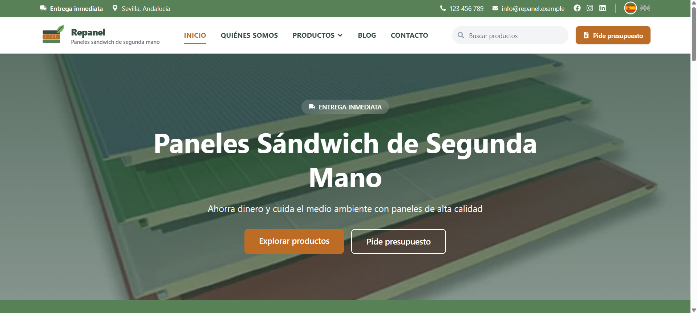
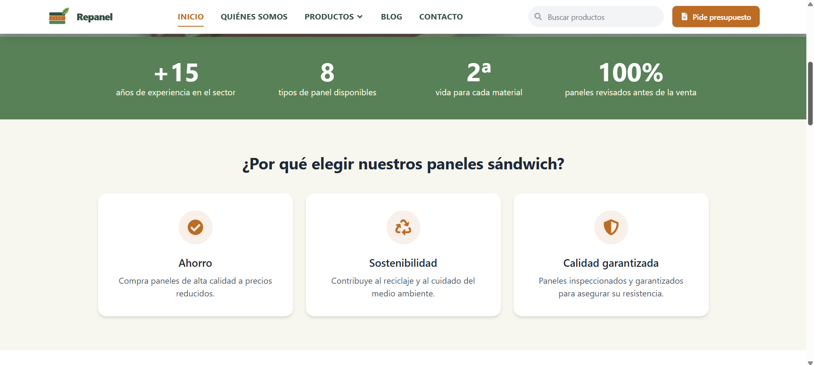
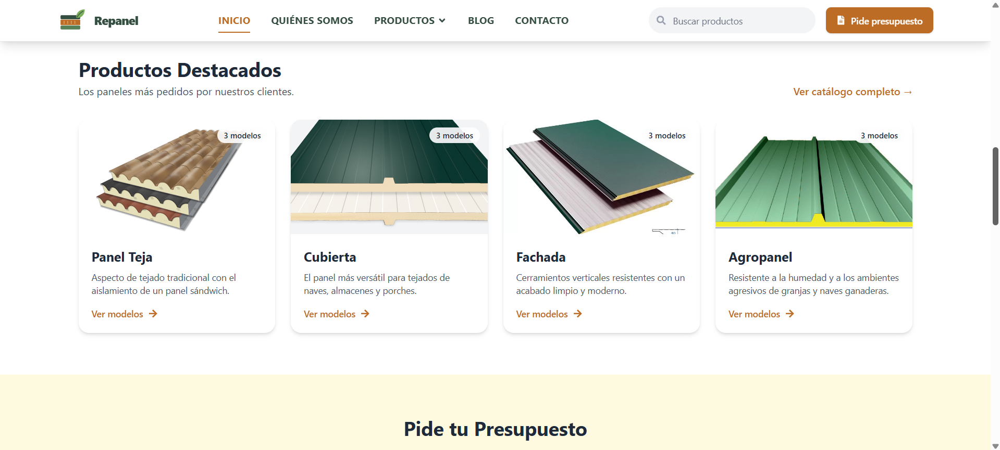
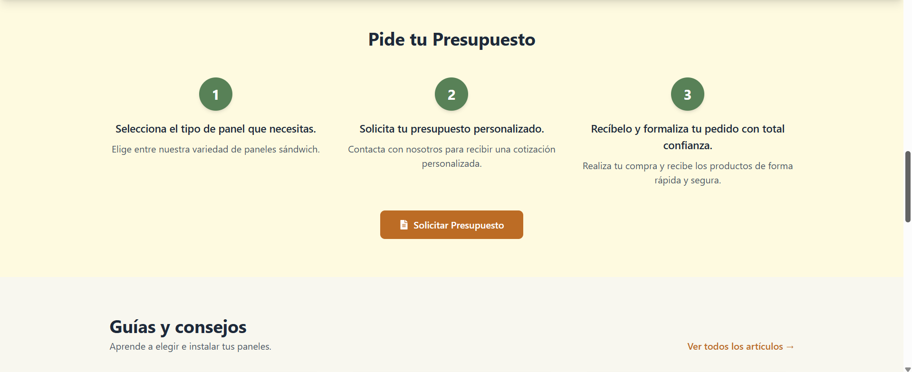
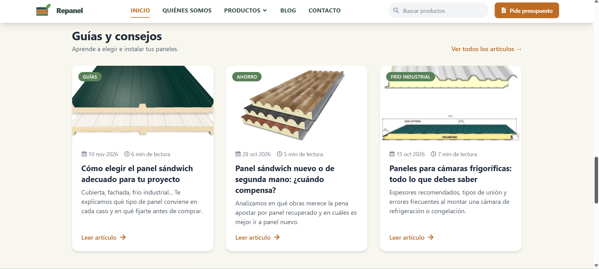
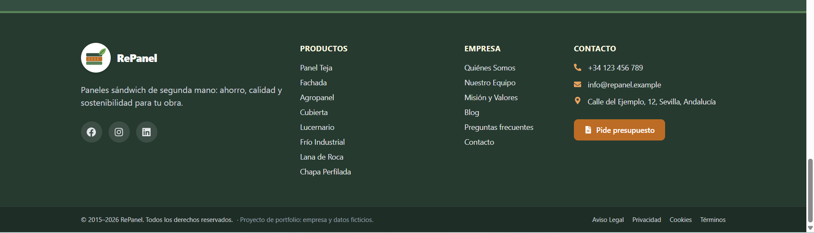

# RePanel · Web de paneles sándwich de segunda mano


Web corporativa para **RePanel**, una empresa de venta de paneles sándwich de segunda mano en Sevilla. Incluye catálogo de productos por categorías, fichas de producto, buscador, blog, formulario de presupuesto y versión bilingüe español / inglés.

> 💡 **Proyecto de demostración:** RePanel es una empresa ficticia. Los datos de contacto, direcciones y textos legales son de ejemplo.


<!-- 🔗 **Demo:** https://repanel.vercel.app -->

## ✨ Funcionalidades

- **Catálogo de productos**: 8 categorías (panel teja, fachada, cubierta, frío industrial, lana de roca…) y 27 modelos, con ficha de detalle (espesores, colores con muestras, aplicaciones y características).
- **Buscador** en la cabecera que busca a la vez en categorías, productos y artículos del blog. Ignora tildes y mayúsculas, y prioriza las coincidencias en el nombre.
- **Formulario de presupuesto** con varios productos por solicitud. Si se llega desde una ficha de producto, se rellena solo con ese panel.
- **Blog** con listado y página de artículo.
- **Bilingüe ES / EN** con `i18next`: detecta el idioma del navegador, tiene selector de idioma y actualiza el atributo `lang` del documento.
- **SEO**: título y meta descripción propios en cada página con `react-helmet-async`.
- **Páginas corporativas**: inicio, quiénes somos, contacto (formulario + mapa), preguntas frecuentes e información legal.
- **Diseño responsive** con Tailwind CSS, y menú y buscador adaptados a móvil.

## 📸 Capturas

**Página de inicio**



| Ventajas y cifras | Productos destacados |
|---|---|
|  |  |

| Proceso de presupuesto | Blog |
|---|---|
|  |  |

**Footer**



## 🛠️ Tecnologías

| Área | Herramientas |
|---|---|
| Interfaz | React 18, Tailwind CSS 4, React Icons |
| Navegación | React Router 6, React Router Hash Link |
| Idiomas | i18next, react-i18next, i18next-browser-languagedetector |
| SEO | react-helmet-async |
| Herramientas | Vite 6, ESLint 9 |

## 📁 Estructura del proyecto

```
repanel/
├── public/              # Imágenes, logos y favicons
└── src/
    ├── components/      # Header, Footer, Buscador, LanguageSwitcher, Logo…
    ├── pages/           # Una página por ruta (Home, Productos, Presupuesto, Blog…)
    ├── locals/          # Datos en JSON: productos, categorías, blog y traducciones (es / en)
    ├── utils/           # Lógica del buscador y funciones de productos
    ├── App.jsx          # Definición de rutas
    ├── i18n.jsx         # Configuración de idiomas
    └── main.jsx         # Punto de entrada
```

Los productos, categorías y artículos se guardan en archivos JSON dentro de `src/locals`. Para añadir un producto nuevo basta con añadirlo al JSON, sin tocar el código de las páginas.

## 🚀 Cómo ejecutarlo en local

Necesitas [Node.js](https://nodejs.org/) 18 o superior.

```bash
git clone https://github.com/corderocana-dev/repanel.git
cd repanel
npm install
npm run dev
```

Abre `http://localhost:5173` en el navegador.

| Comando | Qué hace |
|---|---|
| `npm run dev` | Servidor de desarrollo |
| `npm run build` | Genera la versión de producción en `dist/` |
| `npm run preview` | Sirve la versión de producción en local |
| `npm run lint` | Revisa el código con ESLint |

## 🔜 Próximos pasos

- Conectar los formularios de contacto y presupuesto con un servicio de envío (EmailJS, Formspree o un backend propio).
- Publicar la web en Vercel.

## 👤 Autor

**Antonio Cordero Caña** · [GitHub](https://github.com/corderocana)
